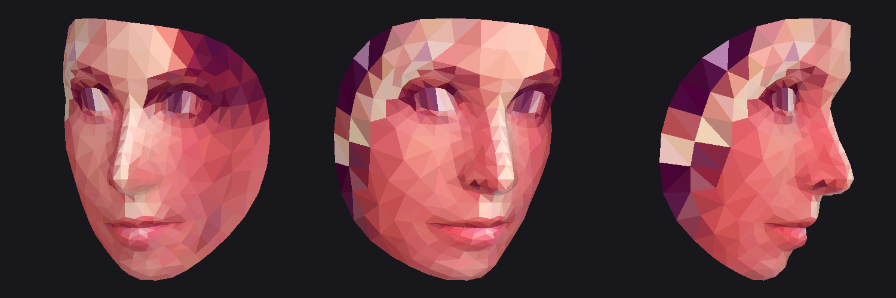

# 셀프 점검: 내 아이디·사진 도용 찾기

**본인** 아이디와 **본인** 얼굴 사진으로 사칭·도용 계정을 찾는 도구입니다.
켜 두면 알아서 돌아가고(무인 실행), 결과를 리포트 파일로 남깁니다.

- 내 아이디를 **255개 사이트**에서 확인합니다 (`selfcheck/sites.py`).
  사이트별 규칙 없이 "존재하지 않을 무작위 아이디"의 응답과 비교해서 자동으로 판별합니다.
- 찾은 계정의 프로필 사진(og:image)을 받아 **내 얼굴과 비교**합니다. 유사도가 높으면 사칭 의심으로 표시합니다.
- 직접 모은 스크린샷 폴더에도 내 얼굴이 있는지 비교할 수 있습니다.
- 얼굴 비교는 OpenCV(YuNet + SFace)로 **내 컴퓨터 안에서만** 처리합니다.

모르는 사람의 사진으로 신원이나 계정을 찾는 기능은 일부러 넣지 않았습니다.

## 설치

```bash
pip install -r requirements.txt
```

얼굴 모델(약 39MB)은 처음 실행할 때 `selfcheck/models/`로 자동으로 받습니다.

## 사용법

```bash
# 아이디만 점검
python selfcheck/run.py --username myid

# 아이디 여러 개 + 내 사진으로 사칭 프로필 판별
python selfcheck/run.py --username myid --username my.id2 --my-photos ./me

# 모아 둔 스크린샷 폴더도 비교하고, 24시간마다 계속 반복 (켜 두기)
python selfcheck/run.py --username myid --my-photos ./me --check-folder ./suspects --repeat-hours 24
```

`./me` 폴더에는 얼굴이 잘 보이는 본인 사진을 3~5장 넣으세요.

결과는 `reports/<날짜-시각>/` 폴더에 저장됩니다.
- `report.html`: 브라우저로 여는 결과표 ("없음"은 숨김)
- `results.csv`: 전체 결과 (엑셀로 열 수 있음)
- `results.json`: 전체 결과 (원본 데이터)

## 결과 읽는 법

| 결과 | 의미 |
|---|---|
| 있음 | 그 아이디의 계정이나 페이지가 있습니다 |
| 있을 수도 | 응답이 달라서 있을 가능성이 있습니다. 직접 확인하세요 |
| 확인 불가(차단) | 사이트가 봇을 막거나 로그인을 요구합니다 (Instagram, Facebook 등) |
| 오류 | 접속 실패나 시간 초과입니다 |

얼굴 유사도가 0.363 이상이면 같은 사람일 가능성이 높습니다. 자동 판별이라 틀릴 수 있으니
의심 계정은 꼭 직접 확인하고, 사칭이 맞으면 해당 플랫폼의 사칭 신고 기능을 이용하세요.

## 옵션

| 옵션 | 기본값 | 설명 |
|---|---|---|
| `--workers` | 24 | 동시에 보내는 요청 수 |
| `--timeout` | 15 | 요청 하나당 제한 시간(초) |
| `--repeat-hours` | 0 | 0보다 크면 이 간격으로 계속 반복 |
| `--out` | reports | 결과를 저장할 폴더 |

## 안드로이드 앱 (APK)

`android/` 폴더가 같은 기능의 안드로이드 앱입니다 (Android 9 이상, arm64 휴대폰).

- 아이디 입력 → (선택) 내 얼굴 사진 고르기 → **점검 시작**
- 화면을 꺼도 백그라운드에서 계속 진행되고, 끝나면 알림이 옵니다
- "24시간마다 자동으로 다시 점검"을 켜면 하루에 한 번 혼자 다시 돌아갑니다
- "의심 사진을 내 얼굴과 비교"로 갤러리 사진(사칭 계정 스크린샷 등)을 바로 비교할 수 있습니다
- 얼굴 모델(약 39MB)은 처음 얼굴 비교할 때 한 번만 내려받습니다
- 등록한 사진을 누르면 **사진 정보**가 나옵니다
  - 파일: 이름, 용량, 해상도, 형식
  - 촬영 정보(EXIF): 촬영 일시, 카메라 제조사·기종, 렌즈, 초점 거리, 조리개, 셔터 속도, ISO, 플래시
  - 위치(GPS): 좌표와 고도. 위치가 들어 있으면 SNS에 올릴 때 노출될 수 있다고 경고합니다
  - 얼굴 분석: 얼굴 수, 얼굴 방향(좌우·위아래·기울기), 미소·눈 감김·입 벌림 정도 (사진 위에 얼굴 점 478개 표시)
- 사진 정보 화면의 **3D 얼굴 모델 보기**
  - 사진 한 장으로 얼굴 3D 메시(점 468개, 삼각형 898개)를 만들고 사진을 입혀 보여 줍니다
  - 한 손가락으로 돌리고, 두 손가락으로 확대/축소합니다. 보기 모드: 사진 입힘 / 음영 / 선
  - **OBJ 저장**: `face.obj` + `face.mtl` + `face.jpg`를 zip으로 묶어 `다운로드/SelfCheck/`에 저장합니다 (Blender 등에서 열 수 있음)
  - 얼굴 앞면만 만들어집니다 (뒷머리·귀는 없음). 사진 한 장에서 추정한 모양이라 실제와 다를 수 있습니다
  - 얼굴 메시 모델(MediaPipe Face Landmarker, 3.7MB)은 앱에 들어 있어서 인터넷 없이도 됩니다



설치: APK 파일을 휴대폰으로 옮겨 열고, "출처를 알 수 없는 앱 설치"를 허용하세요.
디버그 키로 서명되어 있어서 Play 스토어에는 올릴 수 없습니다.

직접 빌드하기 (JDK 17 이상, Android SDK 필요):

```bash
cd android
echo "sdk.dir=/path/to/android-sdk" > local.properties
./gradlew assembleRelease
# 결과: android/app/build/outputs/apk/release/app-release.apk
```
