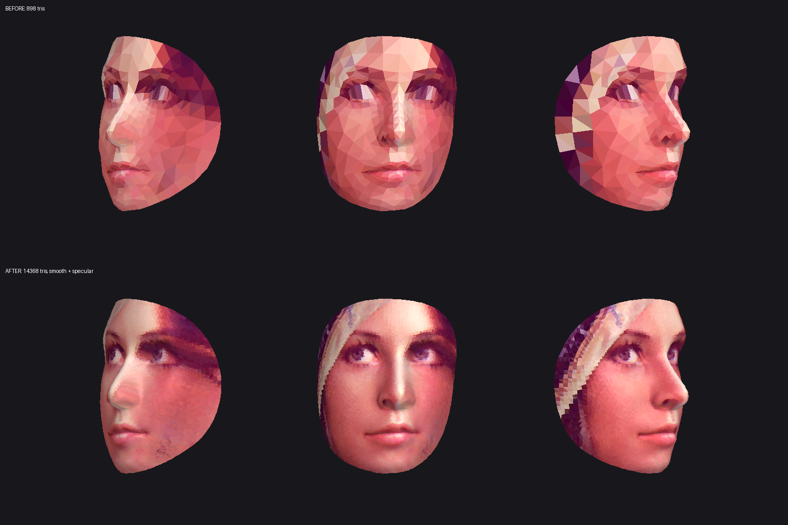
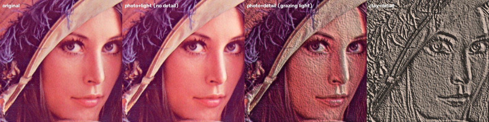
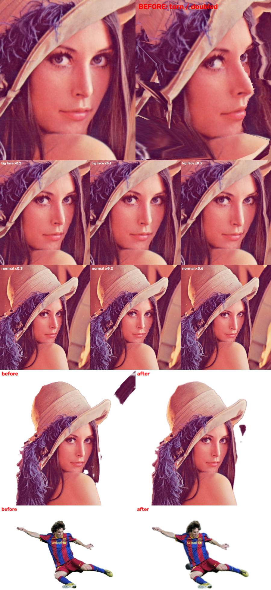

# 셀프 점검: 내 아이디·사진 도용 찾기

**본인** 아이디와 **본인** 얼굴 사진으로 사칭·도용 계정을 찾는 도구입니다.
켜 두면 알아서 돌아가고(무인 실행), 결과를 리포트 파일로 남깁니다.

- 내 아이디를 **255개 사이트**에서 확인합니다 (`selfcheck/sites.py`).
  사이트별 규칙 없이 "존재하지 않을 무작위 아이디"의 응답과 비교해서 자동으로 판별합니다.
- 찾은 계정의 프로필 사진(og:image)을 받아 **내 얼굴과 비교**합니다. 유사도가 높으면 사칭 의심으로 표시합니다.
- 직접 모은 스크린샷 폴더에도 내 얼굴이 있는지 비교할 수 있습니다.
- 얼굴 비교는 OpenCV(YuNet + SFace)로 **내 컴퓨터 안에서만** 처리합니다.

모르는 사람의 사진으로 신원이나 계정을 찾는 기능은 일부러 넣지 않았습니다.

## 설치

```bash
pip install -r requirements.txt
```

얼굴 모델(약 39MB)은 처음 실행할 때 `selfcheck/models/`로 자동으로 받습니다.

## 사용법

```bash
# 아이디만 점검
python selfcheck/run.py --username myid

# 아이디 여러 개 + 내 사진으로 사칭 프로필 판별
python selfcheck/run.py --username myid --username my.id2 --my-photos ./me

# 모아 둔 스크린샷 폴더도 비교하고, 24시간마다 계속 반복 (켜 두기)
python selfcheck/run.py --username myid --my-photos ./me --check-folder ./suspects --repeat-hours 24
```

`./me` 폴더에는 얼굴이 잘 보이는 본인 사진을 3~5장 넣으세요.

결과는 `reports/<날짜-시각>/` 폴더에 저장됩니다.
- `report.html`: 브라우저로 여는 결과표 ("없음"은 숨김)
- `results.csv`: 전체 결과 (엑셀로 열 수 있음)
- `results.json`: 전체 결과 (원본 데이터)

## 결과 읽는 법

| 결과 | 의미 |
|---|---|
| 있음 | 그 아이디의 계정이나 페이지가 있습니다 |
| 있을 수도 | 응답이 달라서 있을 가능성이 있습니다. 직접 확인하세요 |
| 확인 불가(차단) | 사이트가 봇을 막거나 로그인을 요구합니다 (Instagram, Facebook 등) |
| 오류 | 접속 실패나 시간 초과입니다 |

얼굴 유사도가 0.363 이상이면 같은 사람일 가능성이 높습니다. 자동 판별이라 틀릴 수 있으니
의심 계정은 꼭 직접 확인하고, 사칭이 맞으면 해당 플랫폼의 사칭 신고 기능을 이용하세요.

## 옵션

| 옵션 | 기본값 | 설명 |
|---|---|---|
| `--workers` | 24 | 동시에 보내는 요청 수 |
| `--timeout` | 15 | 요청 하나당 제한 시간(초) |
| `--repeat-hours` | 0 | 0보다 크면 이 간격으로 계속 반복 |
| `--out` | reports | 결과를 저장할 폴더 |

## 안드로이드 앱 (APK)

`android/` 폴더가 같은 기능의 안드로이드 앱입니다 (Android 9 이상, arm64 휴대폰).

- 아이디 입력 → (선택) 내 얼굴 사진 고르기 → **점검 시작**
- 화면을 꺼도 백그라운드에서 계속 진행되고, 끝나면 알림이 옵니다
- "24시간마다 자동으로 다시 점검"을 켜면 하루에 한 번 혼자 다시 돌아갑니다
- "의심 사진을 내 얼굴과 비교"로 갤러리 사진(사칭 계정 스크린샷 등)을 바로 비교할 수 있습니다
- 얼굴 모델(약 39MB)은 처음 얼굴 비교할 때 한 번만 내려받습니다
- 등록한 사진을 누르면 **사진 정보**가 나옵니다
  - 파일: 이름, 용량, 해상도, 형식
  - 촬영 정보(EXIF): 촬영 일시, 카메라 제조사·기종, 렌즈, 초점 거리, 조리개, 셔터 속도, ISO, 플래시
  - 위치(GPS): 좌표와 고도. 위치가 들어 있으면 SNS에 올릴 때 노출될 수 있다고 경고합니다
  - 얼굴 분석: 얼굴 수, 얼굴 방향(좌우·위아래·기울기), 미소·눈 감김·입 벌림 정도 (사진 위에 얼굴 점 478개 표시)
- 사진 정보 화면의 **3D 얼굴 모델 보기**
  - 사진 한 장으로 얼굴 3D 메시를 만들고 사진을 입혀 보여 줍니다
  - 고품질 처리: Loop 세분화 2단계(삼각형 898개 → 14,368개), 원본 2048px에서 얼굴만 잘라 낸 1024px 텍스처(밉맵), 하이라이트 조명, 4배 안티앨리어싱, 정면 보정
  - 한 손가락으로 돌리고, 두 손가락으로 확대/축소합니다. 보기 모드: 사진 입힘 / 음영 / 선. 자동 회전 버튼
  - **OBJ 저장**: `face.obj` + `face.mtl` + `face.jpg`를 zip으로 묶어 `다운로드/SelfCheck/`에 저장합니다 (Blender 등에서 열 수 있음)
  - 얼굴 앞면만 만들어집니다 (뒷머리·귀는 없음). 사진 한 장에서 추정한 모양이라 실제와 다를 수 있습니다
- **실시간 카메라** (두 가지 모드)
  - **얼굴 3D**: 여러 얼굴을 동시에 추적합니다. 얼굴마다 "얼굴 #1 · 스캔 중 63%"처럼 스캔 상태를 얼굴 위에 띄우고, 1.5초 스캔이 끝나면 그 얼굴로 만든 3D 모델을 얼굴 옆(공간이 넓은 쪽)에 고정합니다. 모델은 얼굴을 따라다니며 천천히 왼쪽으로 돕니다. 얼굴은 번호로만 구분하고, 누구인지 알아내는 기능은 없습니다.
    버튼: 다시 스캔, 모델 위치(자동/왼쪽/오른쪽), 보기 모드, 앞/뒤 카메라 전환, 원거리 켬/끔
    **얼굴을 누르면** 그 자리에 옵션이 나옵니다: 3D 모델 크게 보기, OBJ로 저장, 모델 숨기기/보이기, 모델 위치 바꾸기, 이 얼굴 다시 스캔, 얼굴 정보(번호, 추정 거리, 얼굴 방향)
  - **원거리 모드** (기본 켬): 분석 해상도 1280×960. 화면을 겹치는 정사각형 조각(짧은 변의 45%, 25%)으로 나눠 프레임마다 하나씩 확대해 먼 얼굴을 찾고, 찾은 먼 얼굴은 주변만 잘라 매 프레임 정밀 추적합니다. 시험 결과 얼굴 약 60px(1280px 화면)까지 1~1.5초 안에 찾았습니다. 물건도 조각 확대로 찾습니다.
  - **줌**: 두 손가락으로 벌리면 카메라 줌, 두 번 누르면 원래대로. 얼굴 위에 추정 거리(눈꼬리 사이 평균 9cm 기준)가 표시됩니다.
  - **제품 인식**: 기기 안에서 80종 사물(컵, 노트북, 휴대폰, 병 등)을 찾아 상자로 표시하고, 왼쪽 위 패널에 설명을 보여 줍니다.
    "API 키"에 Claude API 키를 넣으면 **실시간 검색**: 물건이 0.3초만 보여도 바로 Claude(`claude-opus-5-5`)로 보내고, 결과를 스트리밍으로 받아 제품명이 나오는 대로 상자와 패널에 표시합니다 (동시에 최대 3개). 같은 물건은 추적해서 다시 검색하지 않고, 패널을 누르면 웹에서 그 제품을 검색합니다. 버튼: 실시간 검색 켬/끔, 다시 검색.
    키는 휴대폰에만 저장되고, 분석할 때 사진이 Anthropic 서버로 전송되며 사용량만큼 요금이 나옵니다. 사람은 분석 대상에서 뺍니다.
- 실시간 카메라 성능: 카메라 화면은 미리보기가 원래 속도로 그리고 3D 모델만 투명한 층에 그립니다. 분석은 640×480, GPU 우선(안 되면 CPU), 스캔 중에는 점 468개만 평균 내고 무거운 세분화는 스캔 완료 때 한 번만 합니다.
- 얼굴 메시 모델(MediaPipe Face Landmarker, 3.7MB)은 앱에 들어 있어서 3D 기능은 인터넷 없이 됩니다



- **3D 자세히 보기 (주름·피부 결)**: 사진 정보 화면의 "3D 자세히 보기", 3D 보기 화면의 "자세히 보기", 실시간 카메라에서 얼굴을 누른 메뉴에서 열 수 있습니다.
  - 원본을 4096px로 열어 얼굴을 2048px 텍스처로 쓰고, 메시를 한 단계 더 나눕니다 (삼각형 57,472개)
  - 사진에서 큰 명암(조명·피부색)을 걸러 내고 작은 명암 변화만 뽑아 **노멀 맵**으로 만들어, 주름·모공 같은 굴곡을 표면에 표현합니다 (어두운 주름은 홈으로)
  - 주름 강도 막대, 조명 이동(손가락으로 빛 방향 바꾸기, 비스듬한 빛에서 주름이 잘 보임), 12배 확대, 두 손가락 이동
  - 보기 모드: 사진+주름 / 점토(색 없이 굴곡만) / 선 / 사진만
  - 굴곡은 사진의 명암에서 추정한 것이라 실제 깊이와 다를 수 있고, 눈썹·점처럼 어두운 부분도 홈처럼 보일 수 있습니다. 원본 사진 해상도가 높을수록 자세히 보입니다.



설치: APK 파일을 휴대폰으로 옮겨 열고, "출처를 알 수 없는 앱 설치"를 허용하세요.
디버그 키로 서명되어 있어서 Play 스토어에는 올릴 수 없습니다.

직접 빌드하기 (JDK 17 이상, Android SDK 필요):

```bash
cd android
echo "sdk.dir=/path/to/android-sdk" > local.properties
./gradlew assembleRelease
# 결과: android/app/build/outputs/apk/release/app-release.apk
```

## 편집 (안드로이드 앱)

메인 화면의 **편집** 버튼에서 두 가지를 쓸 수 있습니다.

- **표정 따라하기 (사진·동영상)**: 사진이나 동영상을 고르고 "편집"을 누르면 앞 카메라가 켜집니다. 처음 1초 동안 무표정으로 정면을 보면 기준 표정을 잡고, 그 뒤로는 내 표정과 고개 움직임을 사진 속 인물이 실시간으로 따라 합니다.
  - 따라 하는 것: 입·눈·눈썹 표정, **눈동자 방향**(눈동자 점 10개 포함 478점), 고개 회전(최대 35°)·이동
  - **치아·혀**: 입을 벌리면 내 카메라의 입속을 대상의 입 모양에 맞춰 옮겨 그리고, 색은 대상 피부 톤에 맞춥니다
  - **머리카락도 함께**: 얼굴 둘레의 머리 고리가 고개와 함께 움직이고, 그 바깥 배경은 고정됩니다
  - 떨림 줄이기 필터, 깊이 시험(고개를 돌려 메시가 접혀도 가까운 면만 보임)
  - **겹침 방지**: 머리 둘레 고리는 매 프레임 지금 얼굴 기준으로 사진 안쪽에 잡고 얼굴 윤곽을 따라 움직입니다. 매 프레임 삼각형이 뒤집히는지(얼굴 밖), 사진에 없는 쪽을 억지로 펼치는지(얼굴 삼각형이 3배 넘게 늘어남) 검사해서, 그러면 그 프레임의 움직임을 줄입니다. 그래서 얼굴·머리카락이 겹쳐 그려지지 않습니다 (얼굴이 크게 나온 사진이나 이미 옆을 보는 사진은 움직임이 작아짐). 눈동자는 눈 폭의 25%까지만 움직입니다.
  - 동영상: 반복 재생하면서 인물의 원래 표정 대신 내 표정을 입힘
  - 표정 강도 막대, 기준 표정 다시 잡기, **녹화**(동영상/SelfCheck 폴더에 MP4, **마이크 소리 포함** — 권한을 거절하면 소리 없이)
  - 화면과 녹화 영상에 항상 **"AI 편집"** 표시가 들어가고, 처음 쓸 때 "본인 또는 동의받은 사람의 사진만" 안내가 나옵니다.
  - 남은 한계: 사진 한 장을 변형하는 방식이라 사진에 아예 없는 옆얼굴·뒷머리는 만들어 내지 못합니다.
- **배경 제거 (사진·동영상)**: 사진이나 동영상을 고르고, 남길 물체를 사각형으로 감싼 뒤 "편집"을 누르면 나머지 배경이 지워집니다.
  - **AI 분할**(MediaPipe Interactive Segmenter): 사각형 안 7곳을 가리켜 찾은 물체 모양을 합치고(사각형 근처에 주로 있는 것만), 물체 안쪽 구멍을 메웁니다. 사각형과 겹치는 덩어리는 사각형 밖으로 나간 팔·발까지 통째로 살리고, 떨어진 배경 조각은 버립니다. AI 가 못 찾으면 GrabCut 으로 대신합니다.
  - **복원/지우기 붓** (사진): 결과 화면에서 잘못 지워진 곳은 "복원"으로 문질러 되살리고, 남은 배경은 "지우기"로 지운 뒤 저장합니다.
  - 배경: 투명(사진만, PNG) / 흰색 / 검정 / 초록 / 흐리게
  - 동영상: 프레임마다 AI 로 물체를 다시 찾되 범위는 앞 프레임 물체의 중심을 따라가고 처음 사각형보다 작아지지 않습니다(조금씩 깎여 나가던 문제 해결). 갑자기 물체가 줄면 그 프레임은 앞 프레임 모양을 합칩니다. **원본 소리도 그대로** 들어갑니다.


