# 셀프 점검: 내 아이디·사진 도용 찾기

**본인** 아이디와 **본인** 얼굴 사진으로 사칭·도용 계정을 찾는 도구입니다.
켜 두면 알아서 돌아가고(무인 실행), 결과를 리포트 파일로 남깁니다.

- 내 아이디를 **255개 사이트**에서 확인합니다 (`selfcheck/sites.py`).
  사이트별 규칙 없이 "존재하지 않을 무작위 아이디"의 응답과 비교해서 자동으로 판별합니다.
- 찾은 계정의 프로필 사진(og:image)을 받아 **내 얼굴과 비교**합니다. 유사도가 높으면 사칭 의심으로 표시합니다.
- 직접 모은 스크린샷 폴더에도 내 얼굴이 있는지 비교할 수 있습니다.
- 얼굴 비교는 OpenCV(YuNet + SFace)로 **내 컴퓨터 안에서만** 처리합니다.

모르는 사람의 사진으로 신원이나 계정을 찾는 기능은 일부러 넣지 않았습니다.

## 설치

```bash
pip install -r requirements.txt
```

얼굴 모델(약 39MB)은 처음 실행할 때 `selfcheck/models/`로 자동으로 받습니다.

## 사용법

```bash
# 아이디만 점검
python selfcheck/run.py --username myid

# 아이디 여러 개 + 내 사진으로 사칭 프로필 판별
python selfcheck/run.py --username myid --username my.id2 --my-photos ./me

# 모아 둔 스크린샷 폴더도 비교하고, 24시간마다 계속 반복 (켜 두기)
python selfcheck/run.py --username myid --my-photos ./me --check-folder ./suspects --repeat-hours 24
```

`./me` 폴더에는 얼굴이 잘 보이는 본인 사진을 3~5장 넣으세요.

결과는 `reports/<날짜-시각>/` 폴더에 저장됩니다.
- `report.html`: 브라우저로 여는 결과표 ("없음"은 숨김)
- `results.csv`: 전체 결과 (엑셀로 열 수 있음)
- `results.json`: 전체 결과 (원본 데이터)

## 결과 읽는 법

| 결과 | 의미 |
|---|---|
| 있음 | 그 아이디의 계정이나 페이지가 있습니다 |
| 있을 수도 | 응답이 달라서 있을 가능성이 있습니다. 직접 확인하세요 |
| 확인 불가(차단) | 사이트가 봇을 막거나 로그인을 요구합니다 (Instagram, Facebook 등) |
| 오류 | 접속 실패나 시간 초과입니다 |

얼굴 유사도가 0.363 이상이면 같은 사람일 가능성이 높습니다. 자동 판별이라 틀릴 수 있으니
의심 계정은 꼭 직접 확인하고, 사칭이 맞으면 해당 플랫폼의 사칭 신고 기능을 이용하세요.

## 옵션

| 옵션 | 기본값 | 설명 |
|---|---|---|
| `--workers` | 24 | 동시에 보내는 요청 수 |
| `--timeout` | 15 | 요청 하나당 제한 시간(초) |
| `--repeat-hours` | 0 | 0보다 크면 이 간격으로 계속 반복 |
| `--out` | reports | 결과를 저장할 폴더 |

## 안드로이드 앱 (APK)

`android/` 폴더가 같은 기능의 안드로이드 앱입니다 (Android 9 이상, arm64 휴대폰).

- 아이디 입력 → (선택) 내 얼굴 사진 고르기 → **점검 시작**
- 화면을 꺼도 백그라운드에서 계속 진행되고, 끝나면 알림이 옵니다
- "24시간마다 자동으로 다시 점검"을 켜면 하루에 한 번 혼자 다시 돌아갑니다
- "의심 사진을 내 얼굴과 비교"로 갤러리 사진(사칭 계정 스크린샷 등)을 바로 비교할 수 있습니다
- 얼굴 모델(약 39MB)은 처음 얼굴 비교할 때 한 번만 내려받습니다
- 등록한 사진을 누르면 **사진 정보**가 나옵니다
  - 파일: 이름, 용량, 해상도, 형식
  - 촬영 정보(EXIF): 촬영 일시, 카메라 제조사·기종, 렌즈, 초점 거리, 조리개, 셔터 속도, ISO, 플래시
  - 위치(GPS): 좌표와 고도. 위치가 들어 있으면 SNS에 올릴 때 노출될 수 있다고 경고합니다
  - 얼굴 분석: 얼굴 수, 얼굴 방향(좌우·위아래·기울기), 미소·눈 감김·입 벌림 정도 (사진 위에 얼굴 점 478개 표시)
- 사진 정보 화면의 **3D 얼굴 모델 보기**
  - 사진 한 장으로 얼굴 3D 메시를 만들고 사진을 입혀 보여 줍니다
  - 고품질 처리: Loop 세분화 2단계(삼각형 898개 → 14,368개), 원본 2048px에서 얼굴만 잘라 낸 1024px 텍스처(밉맵), 하이라이트 조명, 4배 안티앨리어싱, 정면 보정
  - 한 손가락으로 돌리고, 두 손가락으로 확대/축소합니다. 보기 모드: 사진 입힘 / 음영 / 선. 자동 회전 버튼
  - **OBJ 저장**: `face.obj` + `face.mtl` + `face.jpg`를 zip으로 묶어 `다운로드/SelfCheck/`에 저장합니다 (Blender 등에서 열 수 있음)
  - 얼굴 앞면만 만들어집니다 (뒷머리·귀는 없음). 사진 한 장에서 추정한 모양이라 실제와 다를 수 있습니다
- **실시간 카메라** (두 가지 모드)
  - **얼굴 3D**: 여러 얼굴을 동시에 추적합니다. 얼굴마다 "얼굴 #1 · 스캔 중 63%"처럼 스캔 상태를 얼굴 위에 띄우고, 1.5초 스캔이 끝나면 그 얼굴로 만든 3D 모델을 얼굴 옆(공간이 넓은 쪽)에 고정합니다. 모델은 얼굴을 따라다니며 천천히 왼쪽으로 돕니다. 얼굴은 번호로만 구분하고, 누구인지 알아내는 기능은 없습니다.
    버튼: 다시 스캔, 모델 위치(자동/왼쪽/오른쪽), 보기 모드, 앞/뒤 카메라 전환, 원거리 켬/끔
    **얼굴을 누르면** 그 자리에 옵션이 나옵니다: 3D 모델 크게 보기, OBJ로 저장, 모델 숨기기/보이기, 모델 위치 바꾸기, 이 얼굴 다시 스캔, 얼굴 정보(번호, 추정 거리, 얼굴 방향)
  - **원거리 모드** (기본 켬): 분석 해상도 1280×960. 화면을 겹치는 정사각형 조각(짧은 변의 45%, 25%)으로 나눠 프레임마다 하나씩 확대해 먼 얼굴을 찾고, 찾은 먼 얼굴은 주변만 잘라 매 프레임 정밀 추적합니다. 시험 결과 얼굴 약 60px(1280px 화면)까지 1~1.5초 안에 찾았습니다. 물건도 조각 확대로 찾습니다.
  - **줌**: 두 손가락으로 벌리면 카메라 줌, 두 번 누르면 원래대로. 얼굴 위에 추정 거리(눈꼬리 사이 평균 9cm 기준)가 표시됩니다.
  - **제품 인식**: 기기 안에서 80종 사물(컵, 노트북, 휴대폰, 병 등)을 찾아 상자로 표시하고, 왼쪽 위 패널에 설명을 보여 줍니다.
    "API 키"에 Claude API 키를 넣으면 **실시간 검색**: 물건이 0.3초만 보여도 바로 Claude(`claude-opus-5-5`)로 보내고, 결과를 스트리밍으로 받아 제품명이 나오는 대로 상자와 패널에 표시합니다 (동시에 최대 3개). 같은 물건은 추적해서 다시 검색하지 않고, 패널을 누르면 웹에서 그 제품을 검색합니다. 버튼: 실시간 검색 켬/끔, 다시 검색.
    키는 휴대폰에만 저장되고, 분석할 때 사진이 Anthropic 서버로 전송되며 사용량만큼 요금이 나옵니다. 사람은 분석 대상에서 뺍니다.
- 실시간 카메라 성능: 카메라 화면은 미리보기가 원래 속도로 그리고 3D 모델만 투명한 층에 그립니다. 분석은 640×480, GPU 우선(안 되면 CPU), 스캔 중에는 점 468개만 평균 내고 무거운 세분화는 스캔 완료 때 한 번만 합니다.
- 얼굴 메시 모델(MediaPipe Face Landmarker, 3.7MB)은 앱에 들어 있어서 3D 기능은 인터넷 없이 됩니다

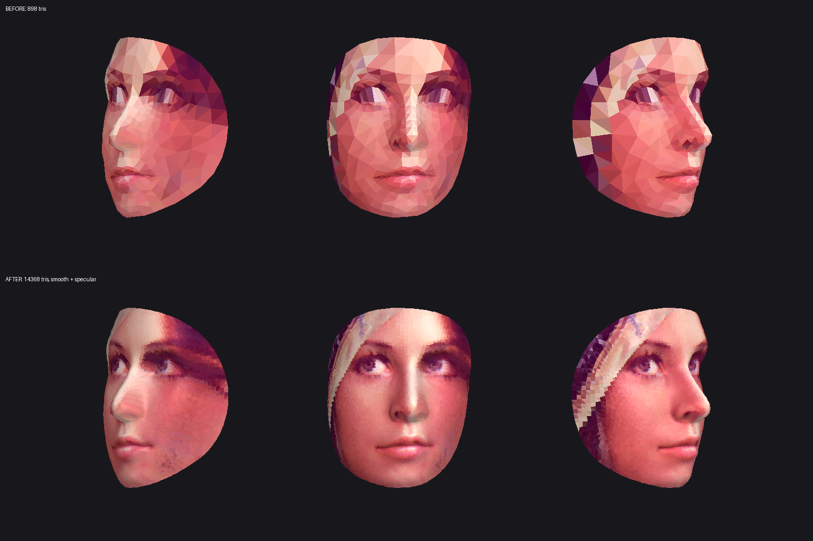

- **3D 자세히 보기 (주름·피부 결)**: 사진 정보 화면의 "3D 자세히 보기", 3D 보기 화면의 "자세히 보기", 실시간 카메라에서 얼굴을 누른 메뉴에서 열 수 있습니다.
  - 원본을 4096px로 열어 얼굴을 2048px 텍스처로 쓰고, 메시를 한 단계 더 나눕니다 (삼각형 57,472개)
  - 사진에서 큰 명암(조명·피부색)을 걸러 내고 작은 명암 변화만 뽑아 **노멀 맵**으로 만들어, 주름·모공 같은 굴곡을 표면에 표현합니다 (어두운 주름은 홈으로)
  - 주름 강도 막대, 조명 이동(손가락으로 빛 방향 바꾸기, 비스듬한 빛에서 주름이 잘 보임), 12배 확대, 두 손가락 이동
  - 보기 모드: 사진+주름 / 점토(색 없이 굴곡만) / 선 / 사진만
  - 굴곡은 사진의 명암에서 추정한 것이라 실제 깊이와 다를 수 있고, 눈썹·점처럼 어두운 부분도 홈처럼 보일 수 있습니다. 원본 사진 해상도가 높을수록 자세히 보입니다.

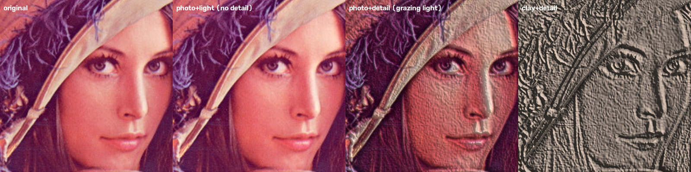

설치: APK 파일을 휴대폰으로 옮겨 열고, "출처를 알 수 없는 앱 설치"를 허용하세요.
디버그 키로 서명되어 있어서 Play 스토어에는 올릴 수 없습니다.

직접 빌드하기 (JDK 17 이상, Android SDK 필요):

```bash
cd android
echo "sdk.dir=/path/to/android-sdk" > local.properties
./gradlew assembleRelease
# 결과: android/app/build/outputs/apk/release/app-release.apk
```

## 편집 (안드로이드 앱)

메인 화면의 **편집** 버튼에서 두 가지를 쓸 수 있습니다.

- **표정 따라하기 (사진·동영상)**: 사진이나 동영상을 고르고 "편집"을 누르면 앞 카메라가 켜집니다. 처음 1초 동안 무표정으로 정면을 보면 기준 표정을 잡고, 그 뒤로는 내 표정과 고개 움직임을 사진 속 인물이 실시간으로 따라 합니다.
  - 따라 하는 것: 입·눈·눈썹 표정, **눈동자 방향**(눈동자 점 10개 포함 478점), 고개 회전(최대 35°)·이동
  - **치아·혀**: 입을 벌리면 내 카메라의 입속을 대상의 입 모양에 맞춰 옮겨 그리고, 색은 대상 피부 톤에 맞춥니다
  - **머리카락도 함께**: 얼굴 둘레의 머리 고리가 고개와 함께 움직이고, 그 바깥 배경은 고정됩니다
  - 떨림 줄이기 필터, 깊이 시험(고개를 돌려 메시가 접혀도 가까운 면만 보임)
  - **겹침 방지**: 머리 둘레 고리는 매 프레임 지금 얼굴 기준으로 사진 안쪽에 잡고 얼굴 윤곽을 따라 움직입니다. 매 프레임 삼각형이 뒤집히는지(얼굴 밖), 사진에 없는 쪽을 억지로 펼치는지(얼굴 삼각형이 3배 넘게 늘어남) 검사해서, 그러면 그 프레임의 움직임을 줄입니다. 그래서 얼굴·머리카락이 겹쳐 그려지지 않습니다 (얼굴이 크게 나온 사진이나 이미 옆을 보는 사진은 움직임이 작아짐). 눈동자는 눈 폭의 25%까지만 움직입니다.
  - 동영상: 반복 재생하면서 인물의 원래 표정 대신 내 표정을 입힘
  - 표정 강도 막대, 기준 표정 다시 잡기, **녹화**(동영상/SelfCheck 폴더에 MP4, **마이크 소리 포함** — 권한을 거절하면 소리 없이)
  - 화면과 녹화 영상에 항상 **"AI 편집"** 표시가 들어가고, 처음 쓸 때 "본인 또는 동의받은 사람의 사진만" 안내가 나옵니다.
  - 남은 한계: 사진 한 장을 변형하는 방식이라 사진에 아예 없는 옆얼굴·뒷머리는 만들어 내지 못합니다.
- **배경 제거 (사진·동영상)**: 사진이나 동영상을 고르고, 남길 물체를 사각형으로 감싼 뒤 "편집"을 누르면 나머지 배경이 지워집니다.
  - **AI 분할**(MediaPipe Interactive Segmenter): 사각형 안 7곳을 가리켜 찾은 물체 모양을 합치고(사각형 근처에 주로 있는 것만), 물체 안쪽 구멍을 메웁니다. 사각형과 겹치는 덩어리는 사각형 밖으로 나간 팔·발까지 통째로 살리고, 떨어진 배경 조각은 버립니다. AI 가 못 찾으면 GrabCut 으로 대신합니다.
  - **사람 분할 함께 사용** (MediaPipe selfie multiclass: 머리카락·얼굴 피부·몸·옷·액세서리): 사각형 안에 사람이 있으면, 물체 AI 가 찾은 모양의 윤곽 안에서 "확실히 사람"인 곳을 채웁니다. 물체 AI 가 머리카락·마스크와 얼굴 피부를 따로 보고 얼굴을 지우던 문제를 막고, 사람이 아니면서 사각형 밖으로 많이 나간 덩어리(천장 등)는 버립니다. 사람 분할은 사각형 주변만 잘라서 돌려 작게 나온 사람도 자세히 보고(사진 전체를 넣으면 다리·팔을 놓침), 물체 AI 가 찾은 부분과 이어진 사람 영역은 다리·발까지 통째로 살립니다. 마지막에 사각형과 거의 겹치지 않는 덩어리(옆 사람 일부 등)는 다시 버립니다.
  - **자연스러운 경계**: 작은 마스크를 그냥 늘리지 않고 원본 사진의 실제 경계에 맞춰 다듬고(가이디드 필터), 경계 화소의 색을 안쪽 물체 색으로 바꿔 배경색 번짐(사람 둘레 초록빛 등)을 없앱니다. 구멍은 AI 가 물체/사람일 가능성이 있다고 본 곳만 메워서, 팔과 몸 사이 잔디 같은 진짜 배경은 지웁니다.
  - **복원/지우기 붓** (사진): 결과 화면에서 잘못 지워진 곳은 "복원"으로 문질러 되살리고, 남은 배경은 "지우기"로 지운 뒤 저장합니다.
  - 배경: 투명(사진만, PNG) / 흰색 / 검정 / 초록 / 흐리게
  - 동영상: 프레임마다 AI 로 물체를 다시 찾되 범위는 앞 프레임 물체의 중심을 따라가고 처음 사각형보다 작아지지 않습니다(조금씩 깎여 나가던 문제 해결). 갑자기 물체가 줄면 그 프레임은 앞 프레임 모양을 합칩니다. **원본 소리도 그대로** 들어갑니다.

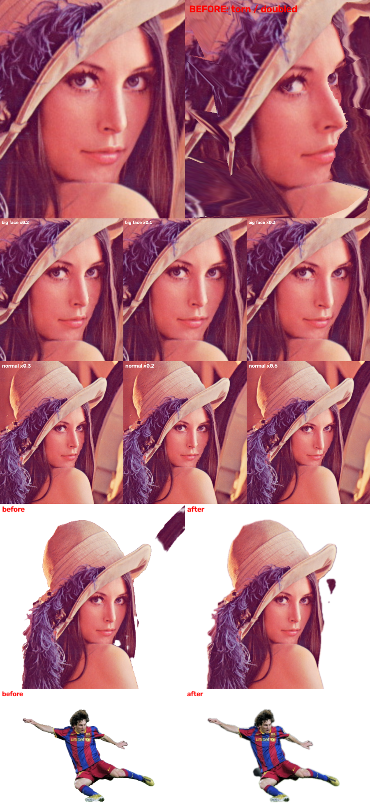

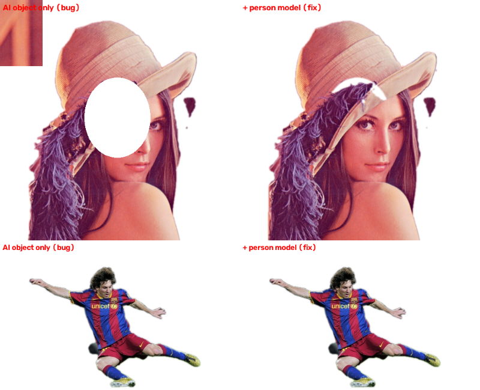

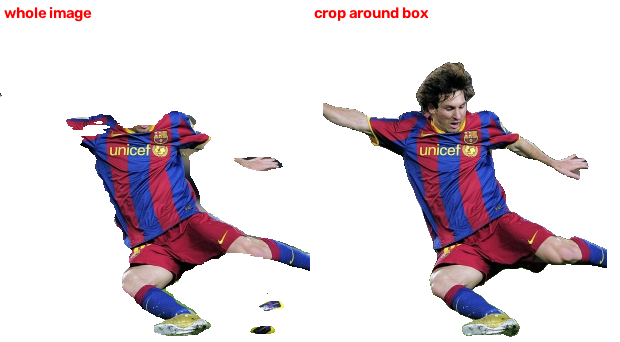

- **크로마키 (그린·블루 스크린)**: 초록/파란 배경에서 찍은 사진·동영상의 배경색을 지웁니다.
  - 가장자리에서 배경색을 자동으로 찾고, 화면을 눌러 지울 색을 바꿀 수 있습니다
  - 색 성분(YCrCb 의 Cr·Cb) 거리로 지워서 그림자·밝기 차이에 덜 민감합니다
  - 막대: 허용 범위, 부드러움(경계 반투명 폭), 색 번짐 제거(초록 배경이면 초록 성분을 눌러 줌), 가장자리 줄이기
  - 배경: 투명(사진, PNG) / 흰색 / 검정 / 다른 사진. 동영상은 MP4(원본 소리 포함)

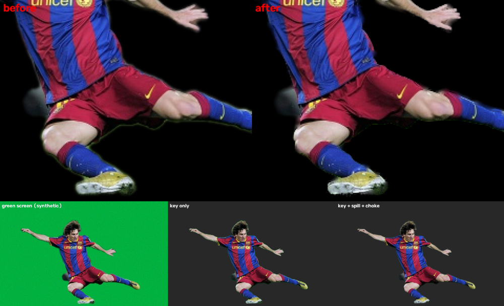

## 번호판 인식 (안드로이드 앱)

메인 화면의 **번호판 인식** 버튼. 뒤 카메라에 비친 대한민국 자동차 번호판을 찾아 사각형으로 표시하고, 확정된 번호는 왼쪽 위 목록에 쌓습니다.

- 글자 인식: Google ML Kit 한국어 글자 인식(휴대폰 안에서만). 읽은 글자 중 번호판 형식("12가 3456", "123가 4567", "서울 12가 3456")에 맞는 줄만 번호판으로 봅니다. 두 줄로 된 구형 번호판은 위아래 줄을 이어 붙여 검사합니다.
- 정확도: 숫자 자리의 비슷한 글자(O→0, I→1, S→5, B→8 등)를 고치고, 번호판에 쓰지 않는 한글은 거릅니다. 같은 번호판을 여러 번 읽어 **다수결**로 확정합니다(2번 이상 같고 다른 후보보다 많을 때). 노란 상자 = 읽는 중, 초록 상자 = 확정.
- 먼 번호판: 두 프레임에 한 번은 화면 가운데를 2배로 키워서 읽고, 두 손가락으로 카메라 줌. 어두우면 "플래시".
- 목록: "목록 저장" 또는 나갈 때 묻는 창에서 저장하면 `다운로드/SelfCheck/plates_날짜_시각.csv`(엑셀로 열 수 있음, 번호판·처음 인식·마지막 인식·횟수)로 남습니다. 저장하기 전까지는 휴대폰 메모리에만 있습니다.
- 번호판 해석 규칙은 단위 테스트(`android/app/src/test/.../PlateParserTest.kt`)로 확인합니다: `./gradlew testReleaseUnitTest`

## 사람 인식 (안드로이드 앱)

메인 화면의 **사람 인식** 버튼. 카메라에 비친 사람을 찾아 몸 관절 33개(뼈대)와 상자를 그리고, 사람마다 번호와 자세를 표시합니다. **누구인지 알아내는 기능은 없습니다** (번호로만 구분).

- 관절: MediaPipe Pose Landmarker(full), 화면 전체에서 최대 5명
- 먼 사람: 두 프레임에 한 번 물체 인식(EfficientDet-Lite2, 사람만)으로 상자를 찾고, 관절을 못 찾은 사람은 그 부분을 확대해서 관절을 다시 찾음(최대 3명). 그래도 안 되면 상자만 표시
- 자세: 서 있음 / 앉음(양쪽 허벅지가 수평) / 누움(몸통이 가로) / 움직임(한쪽 다리만 들림·보폭 큼) / 손 듦(손목이 어깨보다 확실히 위) / 상반신. 화면 밖이거나 가려진 관절(보임 < 0.6 또는 존재 < 0.5)은 판단에 쓰지 않음
- 왼쪽 위: 지금 인원, 누적 인원(3프레임 이상 보인 사람). 버튼: 카메라 전환, 누적 초기화, 뼈대 켬/끔, 두 손가락 줌

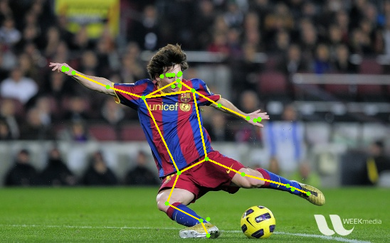

## 인식 기능 개선
- 물체 인식 모델을 EfficientDet-Lite0 → **Lite2**(더 정확, 작은 물체에 강함)로 바꾸고 기준값을 0.35로 조정
- 얼굴·물체·번호판 상자를 부드럽게 따라가게 해서 흔들림을 줄임, 물체 이름은 확신도가 더 높을 때만 바뀜
- 제품 실시간 검색에 보내는 사진 화질을 768px → 1024px로 높임

## 자동 확대 (작게 보이는 대상도 인식)

확대(줌)를 해야만 인식되던 작은·먼 대상을 줌 없이 인식하도록, 사람 인식·번호판 인식·실시간 카메라(원거리 모드)에 같은 방식을 적용했습니다.

- 분석용 사진을 1920×1440 고해상도로 받고, 화면 전체 분석은 줄인 사진(960~1280px)으로 빠르게 합니다.
- 화면을 겹치는 조각으로 나눠 프레임마다 하나씩 **원래 해상도로 잘라** 봅니다 (화면을 좁히지 않고 줌을 한 것과 같은 효과).
- 찾은 작은 대상은 그 주변만 원래 해상도로 잘라 매 프레임 다시 봅니다: 사람은 관절(빠른 Lite 모델), 번호판은 아직 확정 안 된 것만 640px로 키워 다시 읽음.
- 시험(1920px 화면, EfficientDet-Lite2 사람 찾기): 화면 전체로는 키 180px 이하 사람을 못 찾았지만, 원래 해상도 조각으로는 키 80px까지 찾음.

## 정밀 얼굴 스캔 · 도구 모음 (안드로이드 앱 2.0)

메인 화면의 **정밀 얼굴 스캔**, **도구 모음** 버튼으로 엽니다. 사진·얼굴 분석은 모두 휴대폰 안에서만 합니다.

### 얼굴 스캔 정확도
- **얼굴 점 정밀 측정**: 얼굴 부분을 잘라 6가지로 바꿔(그대로·좌우 반전·±5° 회전·0.9배·1.1배) 점을 찾고 점마다 중앙값을 씁니다. 시험 사진에서 점 흔들림이 평균 0.97px → 0.57px(약 40%) 줄었습니다. 사진 정보·3D 모델·정밀 스캔에 적용됩니다.
- 좌우 반전 결과를 합치려고 478개 점의 좌우 짝 번호표(`face_mirror.txt`)를 만들었습니다.

### 정밀 얼굴 스캔
- **주름 (부위별)**: 밝기의 2차 미분(헤시안)으로 "어두운 가는 선"을 세 가지 굵기로 찾고, 길고 가늘며 진하기가 알맞은 선만 남깁니다. 이마·미간·눈가·눈밑·팔자·입가(좌우) 10개 부위 점수(0~100)와 선 개수.
- **잔주름 (미세 주름)**: 더 가는 굵기로 따로 찾습니다. 깨끗한 피부는 0, 대비 10~15%의 아주 옅은 선도 잡습니다.
- **피부 영역**: 사람 분할 모델의 "얼굴 피부"에서 눈·눈썹·입술·콧구멍을 빼고, 피부 경계(머리카락·배경)의 그늘과 코 옆선은 주름으로 세지 않습니다. 돌린 얼굴의 먼 쪽도 포함합니다. 가려진 부위는 "가려짐"으로 표시합니다.
- **모공·잡티·홍조·번들거림·다크서클·톤 불균일·피부결**, **종합 피부 점수**, 촬영 상태 경고(얼굴이 작음·어두움·한쪽 조명·옆얼굴·가려짐).
- 사진 위에 층을 골라 표시: 주름·잔주름·주름 지도(강도 색)·모공·잡티·홍조·번들거림·부위별 점수·얼굴 점. 두 손가락 확대.
- **얼굴 대칭**: 얼굴을 좌우로 뒤집어 3D 로 맞춘 뒤 남는 차이로 점수, 눈·눈썹·입꼬리 높이 차와 코끝·턱끝 치우침(mm).
- **비율**: 3등분, 코밑~입:입~턱, 가로 5등분, 눈 사이/눈 너비 등. **얼굴형**(계란형·둥근형·긴형·각진형·하트형·다이아몬드형).
- **치수**: 홍채 지름(평균 11.7mm) 기준 동공 거리·얼굴 너비/길이·코·입 너비 등 (±10% 추정치).
- **표정**: 표정 이름 + 52가지 값.
- **기록 저장·비교**(휴대폰 안), 결과 사진 저장, 결과 글 복사, **3D 주름 강조 보기**(같은 방법으로 찾은 주름을 3D 표면의 홈으로 더 파고, 머리카락·눈썹의 결은 줄임).
- 검증: 같은 입력(얼굴 부분 사진·점·피부 확률)에서 휴대폰 코드(Kotlin)와 파이썬 시제품의 부위별 주름 점수 10개·잡티 수가 같게 나오는지 단위 시험으로 확인합니다. 시험 사진에서 깨끗한 피부 0~24점, 그려 넣은 주름 50~75점, 실제 웃음 주름 37~57점이었습니다.
- 자동 추정치이며 의료 진단이 아닙니다. 조명·화질·화장·표정에 따라 달라집니다.

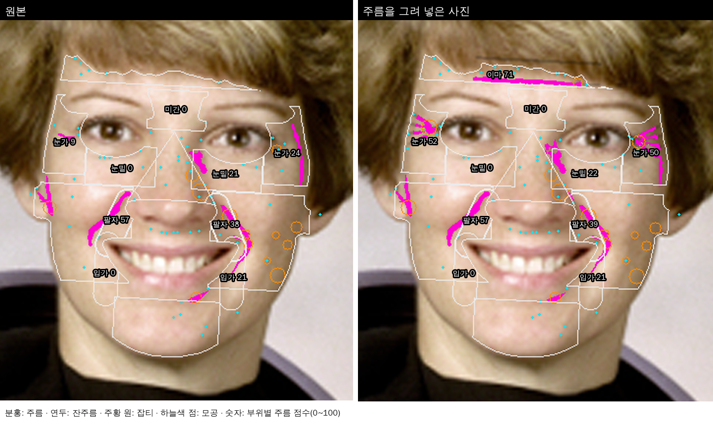

### 도구 모음 (검색 가능)
- **얼굴 보정**: 피부 보정, 잡티 제거, 치아 미백, 눈 키우기, 얼굴 갸름하게, 입술 색, 좌우 대칭 얼굴
- **인물·증명사진**: 인물 배경 흐림, 증명사진 만들기(반명함·여권·명함, 흰 배경, 300dpi, 4×6 인화지 9장)
- **개인정보 보호**: 얼굴 가리기(모자이크·흐림·눈 가리기, 사진 속 모든 얼굴), 번호판 가리기, 촬영 정보·위치(GPS) 지우기, 개인정보 가리기(글: 주민번호·전화·카드·계좌·이메일·주소)
- **사진 편집**: 크기 줄이기·압축, 회전·뒤집기, 자동 밝기·대비, 잡음 제거, 선명하게, HDR 디테일
- **필터·효과**: 흑백, 세피아, 빈티지, 색감 조절, 가장자리 어둡게, 연필 스케치, 만화, 수채화, 픽셀 아트, 워터마크
- **문서·글자·색**: 문서 스캔(모서리 찾아 반듯하게), 글자 추출(한글 OCR), 색상 팔레트
- **실시간 카메라**: QR·바코드 스캔(링크 위험 검사 = 큐싱 방지), 손동작 인식, 손가락 숫자 세기, 스쿼트·팔굽혀펴기·팔벌려뛰기 횟수, 플랭크 타이머, 자세 교정 알림(어깨 기울기·거북목), 졸음 감지, 눈 깜빡임 측정, 미소 셔터, 심박수(얼굴/손가락, 참고용), 색상 찾기, 얼굴 거리 측정, 표정 인식, 물체 개수 세기
- **보안·생활**: 비밀번호 유출 확인(비밀번호는 보내지 않고 해시 앞 5글자만 사용), 비밀번호 강도, 비밀번호 만들기, 스미싱 문자 검사, 링크 안전 검사(+단축 주소 펼치기), QR 코드 만들기(링크·와이파이·연락처), 앱 권한 점검(스토커웨어 의심 조합), 기기 보안 점검
- **센서**: 수평계, 소음 측정, 조도계, 나침반, 진동 측정, 금속 탐지기
- **3D 화면 추가**: STL 저장(3D 프린터), PLY 저장(색 포함), 조명 7가지, 화면 저장
- 사진 도구는 결과에 이어서 다른 도구를 계속 쓸 수 있고, "누르고 있으면 원본"으로 전후를 비교합니다.
- 수정: 매니페스트에 마이크 권한이 빠져 있어 표정 따라하기 녹화에 소리가 들어가지 않던 문제를 고쳤습니다.

## 얼굴 비교 (닮은 정도 % · 같은 사람 판정)

메인 화면의 **얼굴 비교** 또는 도구 모음 → 정밀 얼굴 분석 → 얼굴 비교.

1. **기준 사진**: 비교 기준이 될 사람의 사진을 올리거나 카메라로 찍습니다. 같은 사람 사진을 여러 장(최대 5장) 넣으면 특징을 합쳐서 더 정확하게 판정합니다.
2. **비교할 사진**: 카메라로 찍거나 사진을 첨부합니다.
3. 결과: 두 얼굴, **닮은 정도 %**, 판정(같은 사람으로 보임 / 가능성 높음 / 애매함 / 다른 사람), 얼굴 인식 점수, 사진 상태 경고(얼굴이 작음·흐림·어두움·옆얼굴·가려짐).

- 얼굴 찾기 YuNet, 얼굴 특징 SFace(128차원) — 기존 "의심 사진 비교"와 같은 모델이며 처음 한 번 약 37MB 를 내려받습니다. 비교는 휴대폰 안에서만 합니다.
- 판정 기준: SFace 코사인 유사도 0.363 (OpenCV 권장값, LFW 정확도 99.4%). 닮은 정도 %는 이 값을 읽기 쉽게 바꾼 것으로 **60% 가 같은 사람 기준선**입니다 (0 → 20%, 0.363 → 60%, 0.8 → 98%). 확률이 아닙니다.
- 사진에 얼굴이 여러 명이면 아래 "사진 보기"에서 비교할 얼굴을 누릅니다.
- 시험(가지고 있는 사진 3명): 다른 사람끼리 −0.10~0.13 (15~35%), 같은 사진을 자르기·축소·회전·밝기·흐림·압축·흑백으로 바꾼 경우 0.72~0.97 (90% 이상). 단, 얼굴이 31px 로 아주 작은 사진을 흐리게 하면 같은 사람도 0.30 까지 떨어져서, 작은·흐린 얼굴은 경고를 띄웁니다. 서로 다른 날 찍은 같은 사람 사진으로는 시험하지 못했습니다.
- 쌍둥이·형제자매나 아주 닮은 사람, 오래된 사진, 큰 각도·조명 차이, 마스크·선글라스는 틀리게 만들 수 있습니다. 다른 사람의 사진은 동의를 받고 쓰고, 신분 확인 같은 중요한 판단에는 쓰지 마세요.

## 번호판 조회 (안드로이드 앱)

메인 화면의 **번호판 조회**, 번호판 인식 화면의 **조회** 버튼(인식한 목록에서 고르기), 도구 모음에서 엽니다.

- **글자 풀이**: 번호판 글자로 알 수 있는 정보만 풀어 줍니다 — 차량 종류(숫자: 승용·승합·화물·특수), 용도(가운데 한글: 자가용 / 사업용 `아바사자` / 택배 `배` / 렌터카 `하허호`), 형식(신형 3자리·2자리·구형 지역 표기와 등록 지역), 형식이 이상할 때(읽기 오류 가능) 경고
- **입력 방법**: 직접 입력, 사진에서 읽기(갤러리), 카메라로 찍기
- **공식 서비스 연결** (본인 차량·정당한 용도): 자동차365, 정부24(자동차 등록원부), 이파인(과태료·범칙금), 안전신문고(불법 주정차·교통 위반 신고)
- **하지 않는 것**: 번호판으로 차 주인의 이름·연락처·주소를 찾는 기능은 넣지 않았습니다. 소유자 정보는 개인정보라 본인이나 정당한 이해관계인(교통사고 피해자 등)이 경찰·보험사·관할 기관을 통해서만 확인할 수 있고, 일반인이 알아내면 스토킹·보복에 악용될 수 있습니다. 앱 안에도 같은 안내를 넣었습니다.
- 번호판 글자에는 소유자·차종·연식·색상이 들어 있지 않으며, 전기차 여부도 글자만으로는 알 수 없습니다.

## 실시간 음성 변조 (안드로이드 앱)

메인 화면의 **실시간 음성 변조** 또는 도구 모음 → 음성. 이어폰을 끼고 [시작]을 누르면 마이크로 말한 소리가 바로 다른 목소리로 나옵니다.

- **60가지**
  - 여성 5: 자연스럽게 · 밝고 높게 · 차분한 낮은 목소리 · 숨소리 섞인 부드러운 · 할머니
  - **소녀 5**: 소녀(밝고 어린) + **가늘고 여린 · 귀여운 · 수줍은 · 맑고 청아한** (높은 음높이 + 목소리 굵기 이동 + 숨소리, 여린 소녀는 아주 작은 떨림까지)
  - **뉴스 여성 5 · 뉴스 남성 5**: 메인 뉴스 앵커 · 아침 뉴스(밝고 경쾌) · 속보(긴박·단호) · 라디오 뉴스(따뜻하고 부드럽게/중저음) · 경제·시사(여)/다큐 내레이션(남). 억양 폭을 줄여 안정되게(속보는 0.6배), 말소리 대역(2~4kHz)을 또렷하게, 저음을 두툼하게, 음량을 고르게(컴프레서)
  - 남성 4, 캐릭터 15, 노래 8, 효과 12 (이전과 같음: 거인·아이·아기·헬륨·다람쥐·요정·고블린·오크·괴물·악마·외계인·유령·로봇·속삭임, 합창단·이중창·오토튠·오페라·떨림·더블링·코러스, 에코·동굴·대성당·욕실·전화기·무전기·확성기·수중·플랜저·트레몰로·8비트·라디오 DJ)
- **슬라이더로 미세 조절**: 음높이(±6반음), 목소리 굵기(70~130%), 효과 세기, 마이크 감도. 프리셋 바꾸기와 슬라이더는 소리를 멈추지 않고 바로 반영됩니다.
- **듣기 설정 (스위치 두 개)**, 변조하는 도중에도 바로 켜고 끌 수 있습니다.
  - **변조 목소리 듣기** (기본 켬): 끄면 변조한 소리를 이어폰·스피커로 내보내지 않습니다. 마이크 → 변조 → **녹음**은 그대로 되므로 소리 없이 녹음만 할 때 씁니다 (상태 표시가 "듣기 끔"). 시작할 때 듣기가 켜져 있는데 이어폰이 연결돼 있지 않으면 안내가 뜹니다 (스피커로 틀면 마이크로 되돌아 들어가 삐— 소리가 날 수 있음). 듣기를 꺼 두면 소리가 나가지 않으므로 안내하지 않습니다.
  - **원본 목소리 섞기** (기본 끔): 끄면 변조된 목소리만 나오고, 켜면 내 원래 목소리가 함께 나옵니다 (**원본 크기** 0~100%, 기본 50%). 섞는 원본은 변조 경로와 같은 시간(알고리즘 지연 44ms)만큼 늦춰서 더하므로 메아리처럼 따로 들리지 않고, 켜고 끌 때 딸깍 소리가 나지 않게 약 5ms 에 걸쳐 서서히 바뀝니다. 에코·동굴·무전기처럼 **원본 소리에 효과만 입히는 프리셋**은 원본을 뺄 수 없어서 스위치가 꺼져 있고 이유가 표시됩니다.
  - 마지막에 쓴 프리셋·슬라이더·두 스위치·분류, 최근 쓴 프리셋 6개는 기억해 두었다가 다음에 열면 그대로 나옵니다.
  - **한계**: 말할 때 **귀로 직접 들리는 내 목소리**(공기·뼈로 전해지는 소리)는 앱이 끌 수 없습니다. 귀를 막는 이어폰을 쓰면 변조된 소리가 더 또렷하게 들립니다.
- **녹음·공유**: 변조한 소리를 WAV 로 `음악/SelfCheck/`에 저장하고 공유합니다. 입력·출력 음량 막대, 내 평균 음높이 → 변조 후 음높이(Hz), 예상 지연을 화면에 표시합니다.

### 자연스러운 소리를 위한 방법
- 음높이만 올리면 "다람쥐 소리"가 되므로 **음높이(F0)와 목소리 굵기(포먼트)를 따로** 바꿉니다 (PSOLA: 주기 두 개 길이의 조각을 새 음높이 간격으로 겹쳐 붙이고, 조각을 빠르게/느리게 읽어 굵기만 이동). 조각 위치는 앞 조각과 파형이 가장 비슷한 곳으로 맞춥니다.
- 여성·남성·소녀·뉴스 변환은 **내 평소 음높이를 재서**(YIN, 말하는 동안 계속 갱신) 목표 높이로 옮기고, 억양은 `목표 × (내 음높이/평균)^k`로 유지합니다 (k=1 그대로, 0.6 이면 단조롭게, 1.28 이면 통통 튀게). 굵기는 음높이 변화량의 0.3제곱쯤만 함께 옮깁니다. 이미 여성인 목소리에 "여성"을 걸면 거의 바뀌지 않습니다.
- 자음(무성음)은 음높이를 바꾸지 않고 통과, 목소리 끝자락은 직전 음높이를 잠깐 유지, 프리셋 교체는 30ms 크로스페이드, 출력 음량은 입력에 천천히 맞춥니다.

### 이번 개선 (2차)
- **파형 보간**: 음높이를 많이 올리면 입력의 한 주기를 같은 모양으로 되풀이 붙이게 돼 원래 음높이로 웅웅거리는 소리가 남았습니다. 이웃한 두 주기를 섞어 붙여서(각 주기는 자기 펄스가 가운데) 이를 줄였습니다.
- **음높이 윤곽 평활화**: 이웃 프레임의 이상치(옥타브 튐)를 걷어 내고 가중 평균. 목소리 굵기 값도 조각 몇 개에 걸쳐 부드럽게 이동.
- **한 옥타브 넘게 낮출 때** 조각 창이 입력 주기를 여러 개 품어 음높이가 흐려지던 문제를 창 길이 상한으로 해결 (여성 238Hz → 100Hz 에서 190Hz 로 잘못 나오던 것이 112Hz 로).
- **비브라토**: 소리가 시작되자마자 걸리지 않고 약 0.1~0.26초 뒤에 서서히 커지며, 속도·깊이가 느리게 조금씩 흔들림 (오페라·할머니·할아버지·떨림). 합창·더블링은 겹마다 다른 느린 음높이 흔들림과 굵기 차이, 오토튠은 목표 음에 미끄러져 따라감(강하게 6ms / 부드럽게 70ms).
- **숨소리**도 목소리와 같은 굵기 배율로 스펙트럼이 이동해서 숨소리만 원래 목소리에 머물러 따로 놀지 않음. 에코는 되풀이할수록 어두워지고, 리버브는 프리딜레이와 고음 흡수를 넣음.

### 검증 (컴퓨터에서 측정, 사람이 귀로 들어 본 것은 아님)
합성 음성(espeak 남성 4·여성 3, 영어·한국어) 7개에 같은 조건으로 적용해 전/후를 비교했습니다 (독립 분석기 pyworld, 옥타브 오류는 탐색 범위로 제한).

| 설정 | 입력 음높이 웅웅거림 (전→후) | 소리 주기성 (전→후) |
|---|---|---|
| 음높이 ×2 | 0.039 → 0.010 | 0.785 → 0.810 |
| 여성(자연스럽게) | 0.047 → 0.014 | 0.759 → 0.786 |
| 아이 | 0.042 → 0.012 | 0.780 → 0.790 |
| 할머니 | 0.054 → 0.018 | 0.779 → 0.804 |
| 음높이 ×1.5 | 0.054 → 0.033 | 0.748 → 0.789 |

- 음높이 ×1.5 의 출력/입력 음높이 편차는 0.0151 → 0.0097. 다만 **낮추는 쪽**(굵은 저음)은 음높이 안정성이 거의 같거나 약간 나빠졌습니다 (0.0277 → 0.0306).
- 새 프리셋 14가지: 목표 음높이 ±1~3Hz 일치, 목소리 굵기 측정값이 설계값과 일치 (예: 귀여운 소녀 1.46/1.46, 뉴스 앵커 여 1.11/1.12), 음량 입력의 0.95~1.0배, 피크 0.9 이하. 억양 폭(뉴스 0.6~0.9배, 귀여운 소녀 1.28배)은 설계값으로 정해지며, 출력에서 독립적으로 잰 값은 측정 잡음이 커서 정확히 확인하지 못했습니다.
- 음성 변조 단위 시험 37개 통과 (비브라토 지연, 파형 보간, 숨소리 굵기 이동, 프리딜레이, 에코, 오토튠, 합창 겹 흔들림, 프리셋 60가지 안정성·음량·속도, **원본 목소리 섞기 켜짐/꺼짐·말하는 도중 전환 시 딸깍 소리 없음·효과 전용 프리셋 구분**, 카드 이름 나누기·줄바꿈 도우미 포함). 모든 프리셋 처리 속도는 소리 길이의 약 4% (컴퓨터 기준).
- **한계**: 휴대폰에서 실제로 돌려 보지 못했고 귀로 듣고 고른 것이 아닙니다. 소녀·뉴스 아나운서는 음높이·억양 폭·목소리 굵기·숨소리·음색(EQ)·음량 정리로 **비슷한 느낌을 내는 근사**이며, 실제 아나운서의 말투·속도·발음은 만들어 내지 못합니다. 남성이 아주 높은 소녀 목소리(예: 평소 110Hz → 318Hz)를 내려면 음높이를 2.9배, 굵기를 1.5배 옮겨야 해서 변환 한계에 가깝습니다. 시험 음성이 합성음이라 실제 마이크 목소리에서는 음높이 추적이 더 흔들릴 수 있습니다.
- 지연은 알고리즘 44ms + 오디오 입출력 버퍼(폰마다 다름)라 대략 100~150ms 로 예상되며 블루투스 이어폰은 0.2초 이상 늘어납니다. 안드로이드 제한으로 통화나 다른 앱의 마이크로 변조한 목소리를 보낼 수는 없습니다 (이 앱에서 듣거나 녹음해서 공유). 다른 사람을 속이는 용도(사칭·보이스피싱 등)로 쓰지 마세요.
- 변환 샘플: `voice_samples/` (합성 남성 뉴스 문장 → 소녀 4가지·뉴스 여성 5가지·뉴스 남성 5가지, m4a)

## 화면 디자인 개편 (안드로이드 앱 2.1)

앱 전체 화면을 하나의 디자인 체계로 다시 만들었습니다 (`UiKit.kt`, `res/values/styles.xml`). 기능은 그대로입니다.

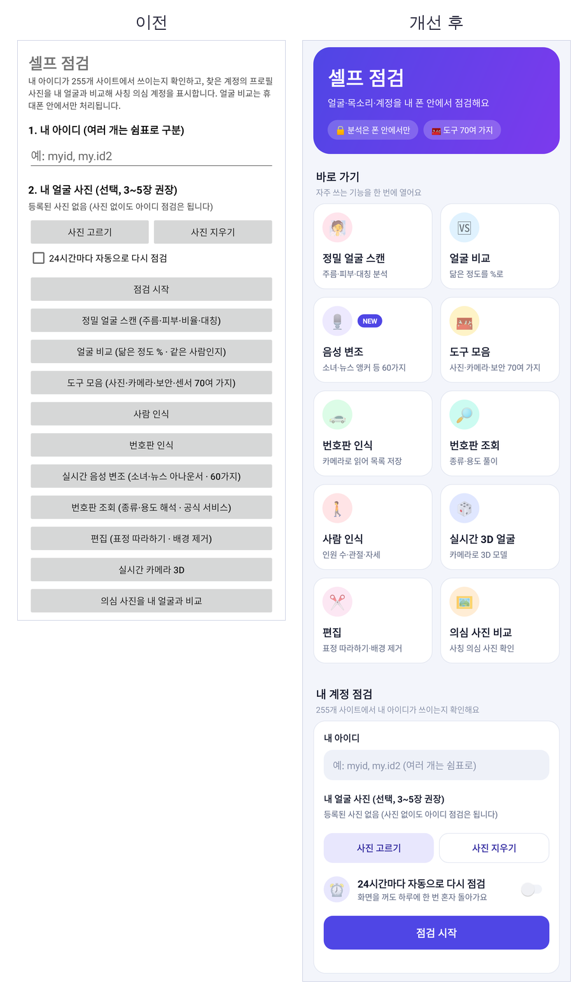

- **색과 모양**: 보라 계열 대표색(#4F46E5)과 연한 배경, 흰 카드(모서리 16~18dp, 얇은 테두리와 그림자), 둥근 버튼과 알약 모양 칩, 눌렀을 때 물결 효과. 기본 `Button` 도 같은 모양(`Theme.SelfCheck`)이라 새 화면을 추가해도 따로 꾸미지 않으면 이전의 회색 네모 버튼으로 돌아가지 않습니다.
- **홈**: 위쪽 소개 카드, "바로 가기" 10개 기능을 아이콘이 있는 같은 높이 카드 격자로, 내 계정 점검은 입력 칸·사진·스위치·시작 버튼이 한 카드에 들어가게 정리했습니다. (이전에는 같은 모양의 회색 버튼이 세로로 길게 나열)
- **음성 변조**: 맨 위에 고른 목소리와 입출력 음량 막대·지연·음높이, 그 아래 듣기 설정 스위치 두 개, 분류 칩(여성·소녀·뉴스 여성·남성·뉴스 남성·캐릭터·노래·효과·최근) + 목소리 카드 2열, 세부 조절 슬라이더, 화면 아래에 고정된 [녹음]/[시작] 버튼.

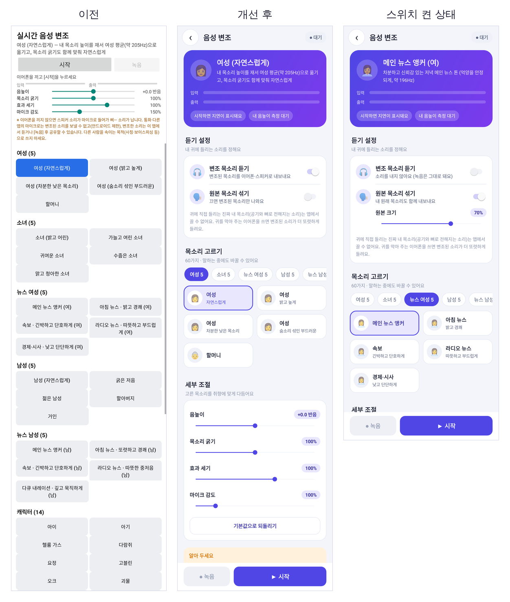

- **도구 모음·점검 화면**: 검색 칸, 분류 칩, 아이콘 카드 목록. 얼굴 스캔·얼굴 비교·번호판 조회·사진 도구·센서·편집·사진 정보 화면도 같은 카드·칩·막대 모양으로 바꿨습니다. 카메라 화면(사람·번호판·실시간·편집)은 어두운 배경에 어두운 회색 둥근 버튼입니다.
- 카드의 짧은 글은 한글 낱말 가운데서 줄이 바뀌지 않게 해서 "여 / 성" 처럼 한 글자만 다음 줄로 넘어가는 일이 없게 했습니다 (공백에서만 줄을 바꿈. 복사해 가는 결과 글에는 적용하지 않음).
- 사진 정보 화면의 EXIF "초점 거리: null" 로 나오던 오류도 함께 고쳤습니다.

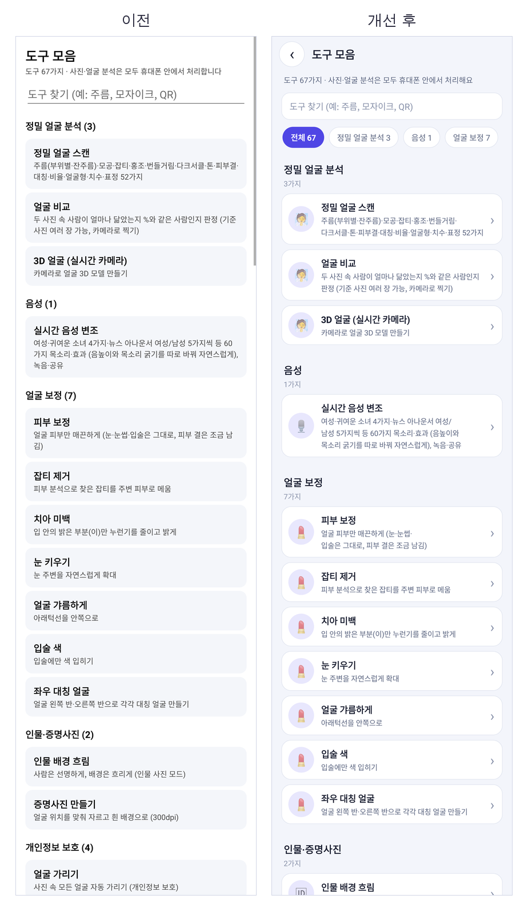

### 화면 그림 만들기 (휴대폰 없이 컴퓨터에서)
화면 모양은 Robolectric(안드로이드 그래픽 라이브러리 그대로)으로 컴퓨터에서 그려 PNG 로 저장해 확인했습니다. `UiShotTest`(화면 27장) 는 평소 시험 때는 건너뛰고 `-PuiShots` 를 줄 때만 돕니다.

```bash
cd android
./gradlew testReleaseUnitTest --tests '*UiShotTest*' -PuiShots=/저장/폴더 -PuiTag=after
# 파일 이름: after_home.png, after_voice.png, after_tools.png ...
# 안드로이드 SDK 파일(android-all-instrumented-15-robolectric-12650502-i7.jar)을 미리 받아 둔 폴더가 있으면
# -ProbolectricDir=/그/폴더 를 주어 인터넷 없이 돌릴 수 있음 (없으면 Robolectric 이 알아서 내려받음)
```

- **한계**: 위 그림은 컴퓨터에서 흉내 낸 화면이며 **실제 휴대폰에서 눌러 보며 확인한 것이 아닙니다**. 글꼴·이모지 모양은 기종에 따라 다를 수 있고(Android 9~10 에서 안 보이는 이모지는 쓰지 않았습니다), 카메라 화면은 카메라 영상 없이 버튼 배치만, 번호판 인식 화면은 그림을 만들지 못했습니다.

## 네트워크 도구 (안드로이드 앱)

메인 화면의 **포트 검사**·**IP 찾기** 카드, 또는 도구 모음 → 네트워크(5가지)에서 엽니다. 내가 관리하는 장비(공유기·NAS·서버·카메라)에 의도하지 않게 열린 문이 없는지 점검하는 용도입니다.

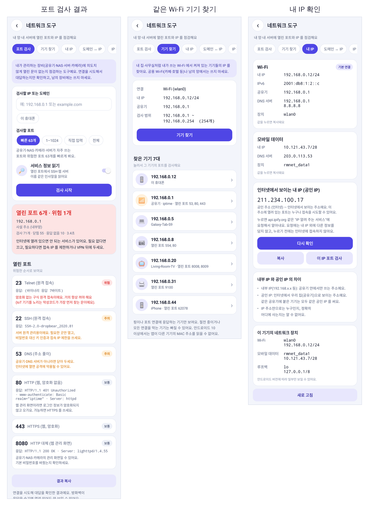

- **포트 검사**: IP(또는 도메인, `https://…` 붙여 넣기도 됨)를 넣으면 열려 있는 포트를 찾습니다.
  - 범위: **빠른**(설명이 있는 주요 63개) · 1–1024 · 직접 입력(`22,80,443,8000-8100`) · 전체 1–65535(내 망 안 장비만)
  - 결과: 열림/닫힘/응답 없음을 구분하고, 열린 포트마다 서비스 이름과 **위험·주의·보통** 표시, 어떻게 하라는 설명(예: 23 Telnet "암호화 없는 구식 원격 접속, 거의 항상 꺼야 해요", 3389 RDP, 445 SMB, 554 카메라 영상, 6379 Redis, 5555 ADB 등)을 보여 줍니다. 결과 복사 가능.
  - 서비스 정보 읽기(켜고 끌 수 있음): 열린 포트에서 SSH·FTP 같은 **인사말**을 읽고, 웹 포트(80·8080 등)에는 `HEAD /` 요청 한 번만 보내 서버 이름(예: `Server: lighttpd`, 공유기 로그인창 이름)을 읽습니다. 그 밖에는 연결만 하고 아무것도 보내지 않습니다.
  - 검사 방식은 **평범한 TCP 연결 시도**뿐입니다 (연결됨=열림, 거부=닫힘, 대답 없음=방화벽이 숨겼거나 장비 없음).
- **같은 Wi-Fi 기기 찾기**: 지금 연결된 Wi-Fi(이더넷)의 /24 범위(최대 254개)에서 핑과 주요 포트 연결 시도로 켜져 있는 기기를 찾고, 이름(역방향 DNS)·열린 포트로 공유기·카메라·프린터·TV 등을 짐작해 보여 줍니다. 기기를 누르면 그 IP 로 포트 검사가 바로 열립니다. 안드로이드 9 이하에서는 ARP 표에서 MAC 주소도 보입니다.
- **내 IP 확인**: 연결된 망마다 내 IP·IPv6·공유기·DNS 서버, 그리고 인터넷에서 보이는 **공인 IP**(버튼을 눌렀을 때만 `api.ipify.org` 등에 요청, 내 IP 외에 아무것도 보내지 않음). 내부 IP 와 공인 IP 의 차이 설명.
- **도메인 ↔ IP 변환**: 도메인의 IPv4·IPv6 주소(주소마다 종류 표시)와 IP 에 등록된 이름 찾기, 한글 도메인 가능.
- **IP 정보 · 서브넷 계산**: 사설/공인/루프백/통신사 공용(CGNAT)/예약 등 종류 판별, 십진·16진·2진 표기, `192.168.0.0/24` 입력 시 네트워크·마스크·와일드카드·브로드캐스트·쓸 수 있는 범위·기기 수.

**남의 장비를 괴롭히지 않도록 둔 제한**
- 인터넷 주소(공인 IP·통신사 공용 주소)를 검사하려면 "내 장비이거나 점검을 허락받았어요"를 확인해야 시작됩니다 (내 망 안 주소·내 공인 IP 는 묻지 않음). 한 번에 대상 하나만, 내 망 밖 주소는 **최대 2,048포트**, 연결은 동시에 24개까지, 취소 버튼 있음.
- 멀티캐스트·브로드캐스트·0.0.0.0·예약 주소는 검사하지 않습니다.
- **하지 않는 것**: 몰래 하는 검사(SYN 만 보내기·주소 위조·조각 패킷), 취약점 공격·비밀번호 대입, 여러 대상·대역을 한꺼번에 검사, **다른 사람의 IP 를 알아내거나 IP 로 위치·신원을 추적하는 기능**(IP 만으로는 정확한 위치도 알 수 없고 스토킹에 악용될 수 있어서 넣지 않았습니다).

**검증과 한계** (컴퓨터에서 시험한 것이며 휴대폰에서 직접 돌려 보지는 못했습니다)
- 단위 시험 25개: IP 읽기(8진수·줄임 표기 거부)·종류 판별(사설·CGNAT 경계값 등 41개 주소)·서브넷 계산·포트 목록 해석·ARP 해석, 컴퓨터 안의 가짜 서버로 열림/닫힘 구분·인사말·웹 서버 이름 읽기·웹 포트가 아니면 아무것도 보내지 않음·진행 표시·취소·기기 찾기·이름 풀이 시간 제한.
- 같은 공유기(Wi-Fi) 안에서 내 **공인 IP** 를 검사하면 공유기가 안쪽으로 되돌려 보내는 방식(헤어핀 NAT)이라 결과가 정확하지 않을 수 있습니다. 모바일 데이터로 바꿔서 검사하세요 (결과 화면에도 안내).
- 모든 연결을 막는 방화벽·절전 중인 기기는 "응답 없음"이거나 기기 찾기에서 빠집니다. 안드로이드 10 이상에서는 앱이 다른 기기의 MAC 주소를 읽을 수 없고, VPN 이 켜져 있으면 같은 Wi-Fi 기기 결과가 달라질 수 있습니다.
- 안드로이드가 핑(ICMP)을 막는 기종이면 기기 찾기는 포트 연결 응답으로만 찾습니다.
- 이 기능은 **내 장비 점검용**입니다. 허락 없이 남의 장비를 검사하면 법에 걸릴 수 있습니다.

## Windows 데스크톱 (EXE)

`desktop/` 폴더: 셀프 점검·배경 제거·크로마키·사람 인식·얼굴 인식을 Windows EXE 로 묶었습니다. 실행하면 PC 안에서만 동작하는 서버가 켜지고 브라우저에 화면이 열립니다. 자세한 내용은 [desktop/README.md](desktop/README.md).
