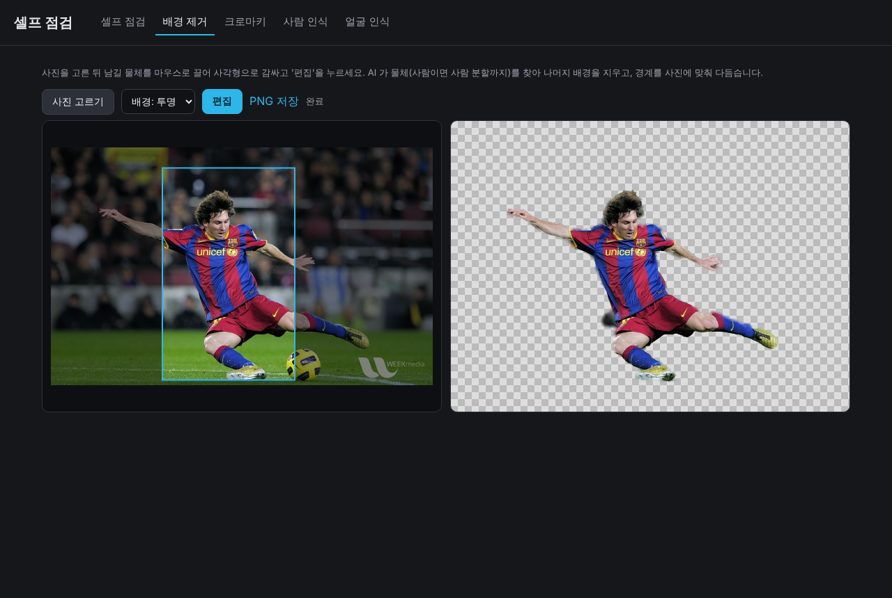
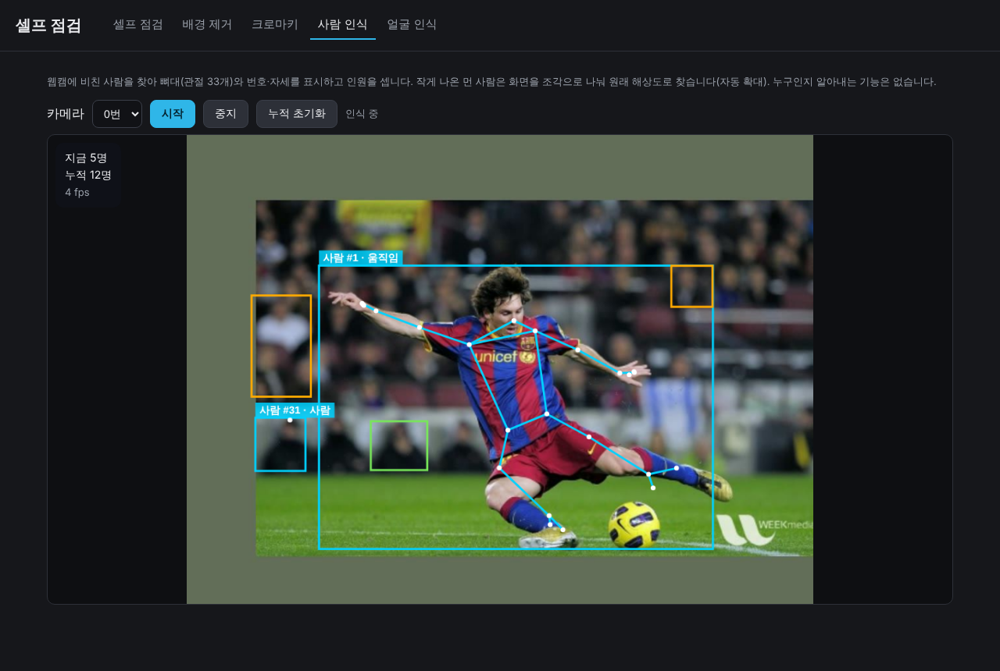

# 셀프 점검 데스크톱 (Windows EXE)

`SelfCheck.exe` 를 실행하면 이 PC 안에서만 동작하는 작은 서버가 켜지고, 브라우저에 앱 화면이 열립니다.
검은 창(콘솔)을 닫으면 프로그램이 종료됩니다. 사진과 웹캠 영상은 PC 밖으로 나가지 않습니다 (아이디 점검만 각 사이트에 접속).

| 탭 | 기능 |
|---|---|
| 셀프 점검 | 내 아이디를 255개 사이트에서 확인, 찾은 계정의 프로필 사진을 내 얼굴과 비교 (사칭 의심 표시) |
| 배경 제거 | 사진에 마우스로 사각형 → AI(물체 + 사람 분할) → 경계 다듬기·색 번짐 제거 → PNG (투명/흰/검정/초록/흐리게/다른 사진) |
| 크로마키 | 초록·파란 배경 자동 감지, 눌러서 색 고르기, 허용 범위·부드러움·색 번짐·가장자리 → PNG |
| 사람 인식 | 웹캠: 뼈대(관절 33개), 번호, 자세(서 있음·앉음·누움·움직임·손 듦), 지금/누적 인원, 먼 사람은 자동 확대 |
| 얼굴 인식 | 웹캠: 얼굴 점, 번호, 인원, 먼 얼굴은 자동 확대 (누구인지 알아내지 않음) |

안드로이드 앱에만 있는 기능: 번호판 인식(휴대폰 한국어 글자 인식 엔진 필요), 표정 따라하기, 3D 보기, 제품 실시간 검색.

## 실행
- Windows 10/11 64비트. 처음 실행은 압축을 푸느라 10~20초 걸립니다.
- Windows Defender SmartScreen 이 "알 수 없는 게시자"라고 경고하면 "추가 정보 → 실행"을 누르세요 (서명하지 않은 프로그램이라 나오는 경고).
- 저장한 결과는 브라우저 다운로드 폴더에 저장됩니다.

## 직접 빌드
Windows 에서 파이썬 3.11(64비트)을 설치하고 이 폴더에서 `build_exe.bat` 실행 → `dist\SelfCheck.exe`.
(MediaPipe 0.10.14 + numpy 1.26 + OpenCV 4.10, Visual C++ 런타임은 `msvc-runtime` 패키지로 함께 묶음)
